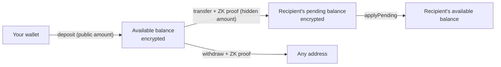

# Dark Core

[](https://github.com/DarkWalletRH/dark-core/actions/workflows/ci.yml)
[](#license)

The vault at the center of [Dark](https://darkwallet.cash): the contract that holds every deposit
and carries out every private transfer and withdrawal of USDG on Robinhood Chain.

Balances in the vault are encrypted. Each one is an ElGamal ciphertext on the Grumpkin curve, so the
chain never sees the amount of a private transfer, or the balance of an account that has used them.
Deposits and withdrawals are public amounts, and so is who pays whom. A private transfer or a
withdrawal is accepted only with a zero-knowledge proof, checked on chain, that the sender owns the
balance, that it covers the amount and, for a transfer, that the amount is encrypted correctly to
the recipient's registered key.

## How a balance moves



- **`deposit`** takes USDG from the caller and adds it to their encrypted balance.
- **`transfer`** moves a hidden amount to another account. The proof binds the chain, this vault,
  both accounts, the sender's nonce and current balance, and the transfer limits.
- **`applyPending`** folds received transfers into the spendable balance. Incoming transfers wait
  in a separate pending balance, so a sender can never invalidate the recipient's own proofs.
- **`withdraw`** proves the balance covers the amount and pays out USDG to any address.

## Contracts

| Path | What it is |
|---|---|
| [`src/DarkVaultCore.sol`](src/DarkVaultCore.sol) | The account paths and the state they share: `deposit`, `transfer`, `applyPending`, `withdraw`, the proof public inputs, the ciphertext arithmetic calls and the limits they enforce. |
| [`src/DarkVault.sol`](src/DarkVault.sol) | The deployed contract: `DarkVaultCore` plus the owner functions (behind a 48-hour timelock), the guardian's emergency controls and the views. |
| [`lib/dark-contracts/`](lib/dark-contracts) | Dependencies, copied verbatim from [DarkWalletRH/dark-contracts](https://github.com/DarkWalletRH/dark-contracts) v1.0.4: the Grumpkin curve library, the key registry, the interfaces and the testnet token used by the tests. |

The zero-knowledge circuits, the generated proof verifiers, the full specification and the
deployment record live in [dark-contracts](https://github.com/DarkWalletRH/dark-contracts).

## Safety properties

- **Exit is never blocked.** `withdraw` and `applyPending` ignore the pause and every limit. No Dark
  role can stop a user from taking their USDG out (the chain operator and the token issuer are
  covered in [AUDIT.md](AUDIT.md)).
- **No admin path to user funds.** There is no proxy, no `delegatecall`, and no setter for the
  token, the registry or the verifiers. `recoverERC20` refuses USDG.
- **Limits with hard ceilings.** Deposits, transfers, each account's net deposits (deposits minus
  withdrawals; private transfers received are not counted) and total value are capped. The ceilings
  are constants in the code. Raising a limit takes the 48-hour timelock, run by a 2-of-3 Safe; the
  guardian Safe (1-of-2) can only tighten limits (lower a maximum or raise a minimum) or pause new
  deposits and transfers, and it acts instantly.
- **Defensive token handling.** Every account function is `nonReentrant`, `deposit` requires the
  exact amount to arrive, and `withdraw` pays out last.
- **Every point is checked.** Ciphertext points supplied by a caller must be canonical, on the curve
  and not the identity.

## Deployment

| Robinhood Chain (4663) | Address |
|---|---|
| DarkVault | [`0xeD7a0c6899a6AC94Aea7A5b2F8f24a948042DA9C`](https://robinhoodchain.blockscout.com/address/0xeD7a0c6899a6AC94Aea7A5b2F8f24a948042DA9C) |
| DarkKeyRegistry | [`0x2E245135FD561965CC546c14C23C9162f36d9C87`](https://robinhoodchain.blockscout.com/address/0x2E245135FD561965CC546c14C23C9162f36d9C87) |
| Owner (TimelockController, 48 h) | [`0xADbF7E3cf5418BeAC10BcDD3BBD9a51dc19EBC54`](https://robinhoodchain.blockscout.com/address/0xADbF7E3cf5418BeAC10BcDD3BBD9a51dc19EBC54) |
| Guardian (Safe) | [`0x87879CbAfC1E92528b950444E693D3b2F07CB1d7`](https://robinhoodchain.blockscout.com/address/0x87879CbAfC1E92528b950444E693D3b2F07CB1d7) |
| USDG | [`0x5fc5360D0400a0Fd4f2af552ADD042D716F1d168`](https://robinhoodchain.blockscout.com/address/0x5fc5360D0400a0Fd4f2af552ADD042D716F1d168) |

All addresses are in [`deployments/4663.json`](deployments/4663.json).

## Verify it yourself

This repository compiles to the runtime code of the mainnet vault, byte for byte apart from the
metadata hash. One command checks it against the chain:

```bash
npm ci
forge build && python3 script/verify-mainnet.py
```

```
DarkVault 0xeD7a0c6899a6AC94Aea7A5b2F8f24a948042DA9C on chain 4663 (read from https://rpc.mainnet.chain.robinhood.com)
  runtime code   13,626 bytes, identical to this build (metadata hash excluded)
  usdg()               0x5fc5360D0400a0Fd4f2af552ADD042D716F1d168
  registry()           0x2E245135FD561965CC546c14C23C9162f36d9C87
  transferVerifier()   0x0905e66f00Bd3261A8E32Dc4b6Cb060a6B8A8f74
  withdrawVerifier()   0xaa921526C05b2F11204525D28A81391d91C4258a
OK: src/ is the code deployed on mainnet
```

`bash script/verify-lib.sh` checks that every file in `lib/dark-contracts` is identical to the
published dark-contracts release. CI runs both checks on every push to `main` and on every pull
request.

## Build and test

Requires [Foundry](https://getfoundry.sh) and Node.js 22.

```bash
npm ci          # OpenZeppelin, forge-std, @noble/curves
forge build
forge test      # unit, boundary, differential and invariant tests
```

`test/DarkGrumpkin.t.sol` checks the curve library against
[@noble/curves](https://github.com/paulmillr/noble-curves) through `node`, so `forge test` uses FFI.

## Security review

[Shieldify](https://shieldify.org) completed an independent security review of the vault
(`src/DarkVaultCore.sol` and `src/DarkVault.sol`) at commit `379bec5` in October 2026. It reported
nine informational findings and nothing of Low severity or above; the report will be published
here when final, and [AUDIT.md](AUDIT.md) lists each finding with our response. The review did not
cover the libraries in `lib/dark-contracts`, the proof verifiers or the Noir circuits.

Found a problem? Please report it privately to **team@darkwallet.cash**. See
[SECURITY.md](SECURITY.md).

## Related repositories

- [dark-contracts](https://github.com/DarkWalletRH/dark-contracts): the circuits, the proof
  verifiers, the specification and the deployment record.
- [dark-sdk](https://github.com/DarkWalletRH/dark-sdk): the TypeScript SDK that builds the proofs
  and decrypts balances.
- [dark-exit](https://github.com/DarkWalletRH/dark-exit): withdraw your USDG with every Dark server
  switched off.

## License

Licensed under either of [MIT](LICENSE-MIT) or [Apache-2.0](LICENSE-APACHE), at your option.
